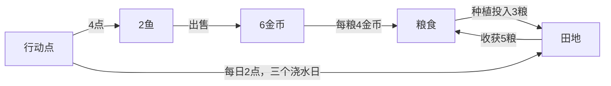

# 新增田地：资源与成长拆解示例

范围：虚构经营规格v0.3，展示规则数据、资源流程及原型边界，不代表真实玩家结果。

## 1. 资源流程

图注：来源[S1]；金币与粮食按整数交易，图中连线表示资源转化，游戏日不等于实际游玩时长。

## 2. 数值与过程

| 路线 | 行动成本 | 投入与产出 | 推演 |
|---|---|---|---|
| 一轮种植 | 2×3=6点 | 投入3粮、收5粮 | 净增2粮；按购粮替代价折算8/6≈1.33金币/点 |
| 一次捕鱼出售 | 4点 | 2鱼售得6金币 | 6/4=1.5金币/点 |
| 新增同规则田地 | 每天再占2点 | 每轮再净增2粮 | 总吞吐增加，单位行动收益沿用原规则 |

来源：[S1，计算]。两种效率是边际折算；实际安排受捕鱼4点一组、浇水2点一组的整数约束影响。若当天剩2点，能够浇水，不能完成一次捕鱼。

下面选择“已有生产进度下如何分配今日行动”作闭环案例。示意起点：今天剩4行动点、0粮、0金币，田已种植并浇过两次；先前种子和行动成本已经投入。目标是今天取得粮食。

| 路线 | 起手与动作 | 当前结果 | 后续状态与边界 |
|---|---|---|---|
| 完成浇水再收获 | 花2点完成第三次浇水，收获不花点 | 得5粮，剩2行动点 | 可保留余点给其他可行操作；田已收获，下一轮需另付种子 |
| 捕鱼、卖鱼再购粮 | 花4点捕鱼，2鱼卖6金币，买1粮花4金币 | 得1粮、剩2金币，行动点用尽 | 田仍保留两次浇水进度，今天的收获推迟 |
| 当前行动点不足 | 若起点改为只剩1点，两条动作均不能执行 | 不能声称当天已取得粮食 | 保留田地进度并结束当天，下个游戏日恢复12点后重新安排 |

依据：[S1，计算与示意条件]。既有进度改变当前可行选择；不能把一轮平均效率直接套用到已投入成本的中途状态。若其他目标也要使用行动点，应同时列出被占用或保留的额度。

## 3. 设计判断与策划启示

新增田提供更多产能，成长价值还取决于余点和粮食需求。持续购粮可用、玩家主要筹金币时，种田未必优先；剩余2点可利用时，新增田仍可能有用。是否产生满足感需玩家观察。

优先拟案：只将新增田收获设为8粮，原有田与浇水规则保留。它检验成长收益，教学和后续资源用途另行判断。若收获前库存20单位，则20+8−24=4单位需丢弃；收获没有消耗，不能预扣下轮种子腾位。暂停仍保留进度，已收获状态不可重复领取。

同起点比较原版与候选，记录自主使用、选择解释、丢弃与其他路线使用。理解正确后仍不选田、收益被容量损失吞掉或路线趋于固定，均可反驳增产方案；不预设改善百分比。

## 资料来源

| 编号 | 资料名称 | 发布者/提供者 | 版本/日期 | 定位 | 支持内容 |
|---|---|---|---|---|---|
| S1 | [经营示例规则](../assets/example-rules.md) | 技能作者；虚构规格 | v0.3 | 规则表 | 行动、种植、价格和库存规则 |

效率和丢弃数量为计算推演；8粮与20库存为拟案及示意起点，均非实测。
